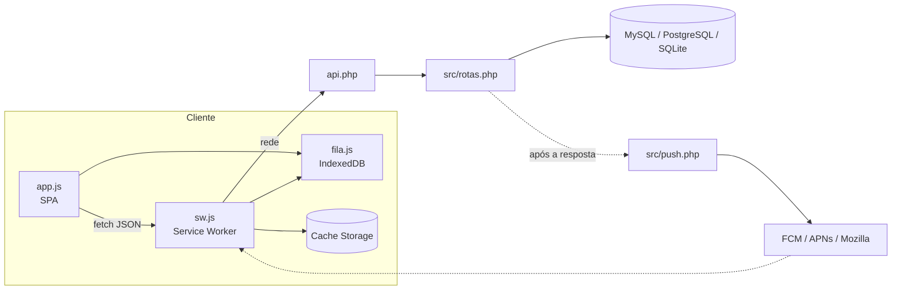

# Controle da Frota

Sistema web de controle financeiro para frotas de caminhões: fretes, gastos, viagens, notas
fiscais e diárias de motoristas, com dois níveis de acesso (motorista e proprietário). É um
PWA instalável que funciona sem internet.


## Stack

| Camada | Tecnologia |
|---|---|
| Back-end | PHP 8, sem framework e sem Composer |
| Banco | MySQL, PostgreSQL ou SQLite via PDO, com o mesmo código |
| Front-end | JavaScript puro (SPA), HTML e CSS, sem etapa de build |
| Offline | Service Worker, Cache Storage, IndexedDB, Background Sync, Web Locks |
| Push | Web Push com VAPID (RFC 8291 e 8292) implementado com `ext-openssl` |
| Relatórios | Gerador de PDF próprio (`src/pdf.php`) |
| Infra | Apache + mod_php; imagem Docker `php:8.3-apache`; deploy no Render |

Extensões PHP usadas: `pdo_mysql` / `pdo_pgsql` / `pdo_sqlite`, `openssl`, `mbstring`, `gd`
(opcional, conversão de imagens para WebP), `curl` (opcional, envio do push).

## Arquitetura



- `index.php` entrega a casca da SPA; todas as telas são montadas em `assets/app.js`.
- `api.php` é o único ponto de entrada da API: `api.php?r=<rota>`, despachado por
  `"<MÉTODO> <rota>"` em `despacha()` (`src/rotas.php`). As respostas são sempre JSON, com
  `{"erro": "..."}` e o status HTTP correspondente em caso de falha.
- Regras de negócio e permissões ficam no servidor; o cliente só exibe o que a API decide
  (por exemplo, `pode_alterar` e `segundos_para_alterar` em cada registro).

## API

| Recurso | Rotas |
|---|---|
| Sessão | `POST login`, `POST logout`, `GET eu`, `POST trocar-senha` |
| Cadastros | `usuarios`, `caminhoes`, `categorias` (GET/POST na coleção; PUT/DELETE em `usuario`, `caminhao`, `categoria`) |
| Viagens | `GET/POST viagens`, `PUT/DELETE viagem`, `POST viagem-encerrar` |
| Lançamentos | `GET/POST lancamentos`, `GET/PUT/DELETE lancamento` |
| Fretes a receber | `GET/POST recebiveis`, `GET/PUT/DELETE recebivel`, `POST recebivel-receber` |
| Notas fiscais | `GET/POST notas`, `PUT/DELETE nota` |
| Diárias | `GET/POST diarias`, `PUT/DELETE diaria`, `POST diarias-pagar` |
| Arquivos | `POST comprovante` (multipart), `GET comprovante` |
| Relatórios | `GET resumo`, `GET receita`, `GET pdf`, `GET pdf-panorama` |
| Avisos e push | `GET avisos`, `POST avisos-lidos`, `GET push-chave`, `POST push-inscrever`, `POST push-cancelar`, `POST push-teste` |

Os itens são identificados por `?id=`. Toda requisição que grava exige o cabeçalho
`X-App-Frota: 1` (proteção contra CSRF junto com o cookie `SameSite=Lax`).

## Banco de dados

| Tabela | Conteúdo |
|---|---|
| `usuarios`, `caminhoes`, `categorias` | Cadastros |
| `lancamentos` | Entradas e saídas numa única tabela; o tipo vem da categoria |
| `viagens`, `diarias`, `notas_fiscais` | Operação |
| `recebiveis` | Fretes a receber; o saldo é calculado a partir dos lançamentos ligados |
| `avisos`, `avisos_vistos` | Registro de atividades e controle de leitura |
| `inscricoes_push`, `configuracoes` | Assinaturas push por aparelho e chaves VAPID |
| `envios_fila` | Idempotência dos envios feitos offline |
| `tentativas_login` | Limite de tentativas de senha |
| `sessoes`, `comprovantes` | Só no PostgreSQL: sessões e arquivos guardados no próprio banco |

- Valores monetários em centavos (`BIGINT`), datas em `AAAA-MM-DD`.
- O DDL é gerado por `estruturaSql()` em `src/banco.php`, com tipos adaptados a cada SGBD.
- **Migração automática:** a tabela `esquema` guarda `VERSAO_ESQUEMA`. Quando a versão sobe,
  a primeira requisição cria as tabelas, adiciona as colunas novas e os índices, sem apagar dados.
- Saldos e valores pendentes nunca são gravados; são sempre derivados por consulta.

## Offline

**Cache (`sw.js`)**
- Casca do app: network-first com fallback para o cache versionado (`controle-frota-<versão>`).
- `GET` da API: network-first; a última resposta de cada consulta fica no cache `frota-dados`.
  Sem rede, ou depois de 8 s com sinal fraco, a resposta guardada é devolvida com o cabeçalho
  `X-Frota-Offline`, que a interface usa para avisar que os dados podem estar desatualizados.
- O cache de dados é apagado no logout e no login, para não expor dados de outra conta.

**Fila de escrita (`assets/fila.js`)**
- `POST` de `lancamentos`, `viagens`, `viagem-encerrar`, `notas` e `diarias` que falham por rede
  (ou estouram 20 s) vão para o IndexedDB, junto com os arquivos anexados (Blob).
- Registros criados offline recebem ids temporários `local:<uuid>`. No envio, a fila resolve as
  dependências na ordem: sobe os arquivos, troca as referências pelos ids reais (por exemplo, um
  gasto ligado a uma viagem criada offline) e grava o mapeamento.
- O envio é disparado pelo evento `online`, pela volta do app ao primeiro plano, por um intervalo
  enquanto houver pendências e pelo Background Sync no Android, que funciona com o app fechado.
  `navigator.locks` impede que a página e o service worker processem a fila ao mesmo tempo.
- Erros de validação (4xx) marcam o item para revisão; erros de rede e 5xx interrompem e tentam
  depois.

**Idempotência (`src/fila.php`)**
- Toda escrita que pode ir para a fila leva `X-Fila-Id`. O servidor reserva o id em `envios_fila`
  antes de executar a rota e guarda a resposta depois. Um reenvio recebe a resposta original
  sem gravar de novo. Uma reserva em andamento devolve `409`; uma falha libera a reserva.

## Notificações push

- Implementação própria em `src/push.php`: par de chaves P-256 gerado na primeira vez e
  guardado em `configuracoes`, JWT ES256 para o VAPID e criptografia `aes128gcm` do conteúdo
  (ECDH, HKDF e AES-128-GCM).
- `registraAviso()` agenda o push para os destinatários; o envio acontece num shutdown function
  depois que a resposta já foi entregue (`Content-Length` declarado + `flush` ou
  `fastcgi_finish_request`), então a latência do serviço de push não afeta a API.
- Assinaturas que retornam `404` ou `410` são removidas.
- O conteúdo inclui a contagem de não lidos, usada pela Badging API no ícone do app.
- No iOS, o push exige iOS 16.4 ou mais novo e o app instalado na tela de início.

## Segurança

- Senhas com `password_hash` (bcrypt); limite de 10 tentativas por usuário a cada 10 minutos.
- Sessão em cookie `HttpOnly`, `SameSite=Lax` e `Secure` quando há HTTPS
  (inclusive atrás de proxy, via `X-Forwarded-Proto`); `session.use_strict_mode` ativado.
- Consultas sempre com prepared statements (`ATTR_EMULATE_PREPARES` desativado).
- Uploads validados pelo conteúdo (`getimagesize` e assinatura `%PDF`), renomeados no servidor
  e servidos apenas pela API autenticada; `uploads/`, `dados/` e `src/` bloqueados por `.htaccess`.
- Permissões e o prazo de edição do motorista são verificados no servidor.

## Executando

### Docker

```bash
docker build -t controle-frota .
docker run -p 8080:80 \
  -e FROTA_BANCO=sqlite \
  -e FROTA_ADMIN_SENHA=troque-esta-senha \
  -v frota-dados:/var/www/html/dados \
  controle-frota
```

### Servidor embutido do PHP

```bash
cd frota
FROTA_BANCO=sqlite php -S localhost:8000
```

### Apache (XAMPP ou hospedagem)

Copie `frota/` para a pasta pública. Sem configuração, o sistema usa MySQL em `127.0.0.1` e
cria o banco `frota` sozinho.

O usuário inicial é `admin`, com a senha definida em `FROTA_ADMIN_SENHA` (padrão `admin123`).
Service worker e push exigem contexto seguro: HTTPS ou `localhost`.

### Render

`render.yaml` descreve o serviço Docker. Defina `DATABASE_URL` (PostgreSQL) e `FROTA_ADMIN_SENHA`.

## Configuração

| Variável | Padrão | Descrição |
|---|---|---|
| `DATABASE_URL` | | URL do PostgreSQL; quando presente, ativa o PostgreSQL |
| `FROTA_BANCO` | `mysql` | `mysql`, `pgsql` ou `sqlite` |
| `FROTA_MYSQL_HOST` / `_PORTA` / `_BANCO` / `_USUARIO` / `_SENHA` | `127.0.0.1` / `3306` / `frota` / `root` / vazio | Conexão MySQL |
| `FROTA_SQLITE_ARQUIVO` | `frota/dados/frota.sqlite` | Arquivo SQLite |
| `FROTA_ADMIN_SENHA` | `admin123` | Senha inicial do `admin` |
| `FROTA_PUSH_CONTATO` | `mailto:contato@controle-frota.app` | Campo `sub` do VAPID |

A versão do app fica em `$v` no `frota/index.php`. Ela versiona os assets e o service worker
(`sw.js?v=`); subir o número força os aparelhos a renovar o cache.

## Estrutura

```
frota/
├── index.php        casca da SPA
├── api.php          entrada da API e idempotência
├── manifest.php     Web App Manifest (ícones, atalhos, share target)
├── sw.js            service worker
├── config.php       configuração por variáveis de ambiente
├── src/
│   ├── banco.php    PDO, DDL por SGBD e migrações
│   ├── sessao.php   sessão, autenticação e handler de sessão no PostgreSQL
│   ├── rotas.php    rotas e regras de negócio
│   ├── push.php     Web Push (VAPID e aes128gcm)
│   ├── fila.php     idempotência por X-Fila-Id
│   ├── pdf.php      gerador de PDF
│   └── util.php     validação e resposta JSON
└── assets/
    ├── app.js       SPA
    ├── fila.js      fila offline (compartilhada com o sw.js)
    └── estilo.css
```

O manual de uso do sistema está em [`frota/README.md`](frota/README.md).
